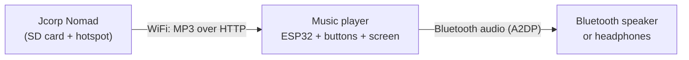

# Idea: Nomad Bluetooth music player

Status: **idea / planning**. Nothing here is built or tested yet.

A small companion device that joins Nomad's WiFi, streams music from the Nomad's
SD card, and plays it on Bluetooth headphones or a Bluetooth speaker. Physical
buttons control playback, so no phone is needed.



## How it works

1. The player joins Nomad's hotspot like any other client (phone, laptop).
2. It asks Nomad for the song list. Nomad already serves a playlist at
   `/playlist.m3u` (marked as outdated in the firmware) and the library index at
   `/api/index`. No changes to Nomad itself are needed.
3. It streams the MP3 in small chunks with HTTP range requests, the same way a
   phone browser does, keeping a few seconds buffered.
4. It decodes the MP3 and sends the audio to the speaker over Bluetooth A2DP.
5. Buttons handle play/pause, previous, next and volume. A small OLED shows the
   track name and battery level.

Software building blocks: [`ESP32-A2DP`](https://github.com/pschatzmann/ESP32-A2DP)
(Bluetooth source) and [`arduino-audio-tools`](https://github.com/pschatzmann/arduino-audio-tools)
(URL streaming + MP3 decoding).

## The chip has to be the original ESP32

Bluetooth audio (A2DP) needs **Bluetooth Classic**. Only the original ESP32
has it. The ESP32-S3 (used by Nomad), C3, C6 and H2 only have Bluetooth Low
Energy and **cannot** stream audio to a speaker. HC-05 / HC-06 serial Bluetooth
modules can't do it either (serial data only, no audio).

## Parts list (about $30-40)

| # | Part | Spec to search for | Qty | Approx. price |
|---|---|---|---|---|
| 1 | ESP32 board | ESP32-WROOM-32 DevKit (30-pin DevKit V1 or 38-pin DevKitC). Must be WROOM-32, not S3/C3/C6. | 1 | $7-10 |
| 2 | Battery | 3.7V 1S LiPo, 2000 mAh, **with protection circuit**, JST-PH 2.0 (size 103450 fits a small case) | 1 | $8-10 |
| 3 | Charger | TP4056 USB-C module **with protection** (6 pads: IN+, IN-, B+, B-, OUT+, OUT-) | 1 | $1 |
| 4 | Boost converter | MT3608 2A adjustable boost module | 1 | $1 |
| 5 | Power switch | SS12D00 slide switch or mini rocker | 1 | <$1 |
| 6 | Screen | 0.96" OLED, SSD1306, 128x64, I2C, 4 pins | 1 | $4 |
| 7 | Buttons | 12x12 mm tactile buttons with caps (or 6x6 mm) | 5 | $3 |
| 8 | Resistors | 100 kOhm | 2 | drawer |
| 9 | Capacitors | 100 nF ceramic x1, 470 uF electrolytic 10V+ x1 | 2 | drawer |
| 10 | Build supplies | Perfboard ~5x7 cm, female pin headers, 22-26 AWG stranded wire, JST-PH 2.0 pigtail, solder | - | drawer |
| 11 | Case | 3D printed (designed after the board is finished) | 1 | printer |

## Wiring

Power path:

```
LiPo (B+/B-) -> TP4056 (OUT+/OUT-) -> switch -> MT3608 IN -> MT3608 OUT (5.0V) -> ESP32 5V pin
```

| ESP32 pin | Connects to |
|---|---|
| 5V | MT3608 OUT+ (5.0V), with the 470 uF capacitor from 5V to GND |
| 3V3 | OLED VCC |
| GND | Common ground (battery -, TP4056 OUT-, MT3608 OUT-, OLED, buttons, divider) |
| GPIO21 | OLED SDA |
| GPIO22 | OLED SCL |
| GPIO32 | Play/pause button, other leg to GND |
| GPIO33 | Previous button, other leg to GND |
| GPIO25 | Next button, other leg to GND |
| GPIO26 | Volume down button, other leg to GND |
| GPIO27 | Volume up button, other leg to GND |
| GPIO34 | Battery sense: midpoint of a 100k/100k divider from the switch output to GND, plus 100 nF from GPIO34 to GND |

Notes:

- Buttons need no external resistors. Firmware enables the internal pull-ups
  (`INPUT_PULLUP`), so a press reads LOW.
- Strapping pins (GPIO 0, 2, 5, 12, 15) are avoided on purpose so a held button
  can't stop the board from booting.
- GPIO34 is input-only and on ADC1, which keeps working while WiFi is on (ADC2
  does not).
- The divider sits after the power switch so it draws nothing when the device is
  off. At 4.2V battery the pin sees 2.1V.

## Safety checks before powering anything

1. **Set the MT3608 to 5.0V before connecting the ESP32.** These modules often
   ship set to around 28V. Power it from the battery, measure OUT+/OUT- with a
   multimeter, and turn the trim pot until it reads 5.0V.
2. **Check the battery connector polarity.** JST battery leads are not
   standardized. Red must go to B+ on the TP4056.
3. **Switch off while the ESP32's USB port is plugged in** for programming, so
   two 5V sources don't fight.
4. **OLED pin order varies by seller** (some start with GND, some with VCC).
   Follow the labels printed on your module.
5. Charge with the switch off for clean charge termination. Rough battery life
   estimate: 4-5 hours on 2000 mAh with WiFi + Bluetooth running.

## Build order

1. Breadboard, USB powered: ESP32 + OLED + buttons. Get the firmware working.
2. Power section alone: battery -> TP4056 -> switch -> MT3608, set and verify 5.0V.
3. Connect the two and test on battery.
4. Move to perfboard, with the ESP32 in female headers so it stays removable.
5. Measure the finished board, design the case, print it.

## Firmware plan

1. Buttons + OLED (read buttons, show a menu).
2. Join Nomad's WiFi and fetch the song list.
3. Stream one MP3 over HTTP and decode it.
4. Bluetooth A2DP output to a paired speaker, then playback controls and volume.

## Known risks

- **WiFi and Bluetooth share one radio** on the ESP32. Coexistence works but can
  cause dropouts, so the player needs a few seconds of buffer.
- **MP3 only** to start. Other formats are heavier to decode on this chip.
- A phone connected to Nomad can already play to Bluetooth headphones. The point
  of this device is a dedicated, phone-free player with physical buttons, and the
  hands-on electronics practice of building it.
