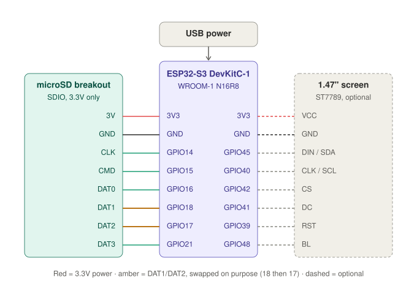

# Idea: main Nomad on an ESP32-S3 DevKitC-1 (N16R8)

Status: **alternative / experimental, untested**. Nobody has confirmed this board
runs Nomad yet. The main build in this fork now uses the official Waveshare
ESP32-S3-LCD-1.47 (see [build-plan.md](build-plan.md)); this guide is kept for
experimenting with the spare DevKitC-1.

Nomad officially targets the Waveshare ESP32-S3-LCD-1.47. This doc covers
running it on a plain **ESP32-S3 DevKitC-1 with the ESP32-S3-WROOM-1-N16R8
module** (16 MB flash, 8 MB octal PSRAM, PCB antenna) by adding an external
microSD socket and, optionally, the same 1.47" screen.

## Why it should work

- Same chip family, same **16 MB flash + 8 MB octal PSRAM** as the Waveshare board.
- The firmware reads the SD card over SDIO on **GPIO 14, 15, 16, 17, 18, 21**
  (`SD_*_PIN` in `JcorpNomadProject.ino`). All six are free on the DevKitC-1
  and don't clash with the octal PSRAM pins (35-37) or native USB (19, 20).
- The screen pins (39, 40, 41, 42, 45, backlight 48) are also broken out.
- The SD mount already falls back from 4-bit 40 MHz to 4-bit 20 MHz to 1-bit
  20 MHz, which helps with breadboard wiring.

## What you need

| Part | Notes | Approx. price |
|---|---|---|
| ESP32-S3 DevKitC-1 (N16R8) | Already owned | - |
| microSD breakout with **SDIO** support | 3.3V only, **no level-shifter chip**, pins labelled CLK, CMD, DAT0-DAT3 (e.g. Adafruit "Micro SD SPI or SDIO Card Breakout - 3V ONLY"). SPI-only modules with a level shifter will **not** work. | $4 |
| microSD card | 128 GB, A1/U3 (exFAT works out of the box) | $12-15 |
| 1.47" ST7789 screen, 172x320, SPI | **Optional.** Must be this exact panel, the firmware's size and offsets are set for it. | $5-8 |
| USB power + data cable | Phone charger or power bank | - |
| Jumper wires / perfboard | Already owned | - |

## Wiring

This is a logical diagram. On the real board the GPIOs are spread along both
headers, so match them by the silkscreen label.

**microSD breakout (required)**

| SD breakout | ESP32-S3 pin |
|---|---|
| CLK | GPIO14 |
| CMD | GPIO15 |
| DAT0 | GPIO16 |
| DAT1 | **GPIO18** |
| DAT2 | **GPIO17** |
| DAT3 | GPIO21 |
| 3V | 3V3 |
| GND | GND |

DAT1 and DAT2 are crossed on purpose (DAT1 to 18, DAT2 to 17). If the breakout
has no pull-ups, add 10 kOhm from CMD and DAT0-DAT3 to 3V3. Keep the wires under
about 10 cm.

**Screen (optional)**

| Screen | ESP32-S3 pin |
|---|---|
| VCC | 3V3 |
| GND | GND |
| DIN / SDA | GPIO45 |
| CLK / SCL | GPIO40 |
| CS | GPIO42 |
| DC | GPIO41 |
| RST | GPIO39 |
| BL | GPIO48 |

Power everything from **3V3, never 5V**.

## Flashing

1. Use the browser flasher at <https://nomadflash.jcorptech.net> (Chrome or Edge).
2. Pick the **USB-A build** (backlight on GPIO48). The USB-C build drives the
   backlight on GPIO46, which is a strapping pin on the DevKitC-1.
3. Try the port labelled **USB** first. If the flasher can't see the board, use
   the **UART** port.
4. Set up the SD card from the same site, insert it and power up.

## Test order

1. SD breakout only. Flash, boot, and check the serial log for
   `[SD] Mounted ...` and that the `Jcorp_Nomad` hotspot appears.
2. Add the screen.

## Known risks

- **GPIO45 is a strapping pin** (flash voltage select). If the board won't boot
  once the screen is connected, unplug the DIN wire, boot, and investigate.
- The onboard RGB LED is on GPIO38 (board v1.0, matches Nomad's status LED) or
  GPIO48 (v1.1, shares the backlight pin and may flicker). Harmless either way.
- The official Nomad case won't fit this board, so it needs a custom case.
