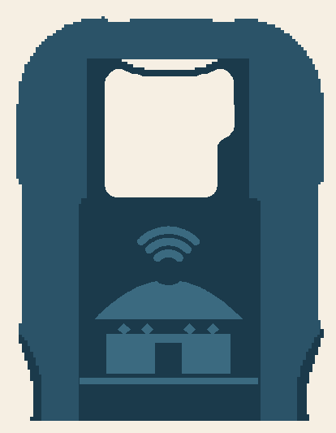

# Khan-Nomad case

The original Nomad v30 case with the **steppe yurt logo engraved into the back
cap**, in place of the original tree logo. Same two parts as the original (back
cap and front frame), same fit. Only the cap changes.

| File | Board | |
|---|---|---|
| `NomadCasev30_KhanNomad_Vented.stl` | USB-A (ESP32-S3-LCD-1.47) | **Recommended:** yurt + vent window |
| `NomadCasev30_USB-C_KhanNomad_Vented.stl` | USB-C (ESP32-S3-LCD-1.47B) | yurt + vent window |
| `NomadCasev30_KhanNomad.stl` | USB-A | yurt only, closed back |
| `NomadCasev30_USB-C_KhanNomad.stl` | USB-C | yurt only, closed back |

## Why vented

The board runs warm: the WiFi hotspot transmits nonstop and the screen backlight
adds heat, and the original cap is a closed tray around the back of the board.

The cap's back plate is 2.2 mm thick except for a ~10 x 12 mm pocket near the top
end that is only **0.4 mm** thick (clearance for parts on the back of the board).
The vented version opens that pocket as a rounded **window (113 mm²)** right over
the board. Its edges are the full 2.2 mm plate, so nothing thin or fragile is left.



The yurt (13.8 x 15.6 mm) sits fully on the 2.2 mm plate. An earlier version put
its WiFi arcs over the 0.4 mm pocket, where the 0.6 mm engraving cut straight
through; both files now use the corrected position.

## Printing (Prusa CORE One or any FDM printer)

- Print exactly like the original case: the parts are already laid out flat, with
  the cap's outside face down on the bed. No supports needed for the logo or the
  window.
- The logo is cut **0.6 mm** deep into that face (3 layers at 0.2 mm), so it shows
  as a recessed yurt on the finished cap.
- Use a 0.4 mm nozzle and 0.2 mm layers or finer. The thinnest logo features (the
  WiFi arcs and the band diamonds) are about 0.6-1 mm wide.
- A smooth or textured PEI sheet both work; textured gives the face a nice matte look.
- PETG handles warmth better than PLA. PLA softens around 55-60 °C, and a
  hotspot running for hours in a pocket gets close to that. PLA is fine for the
  vented version on a desk.

## Two-colour logo (optional)

The engraving is open to the bed, so a filament change makes the logo a different
colour from the face:

1. Start with the **face colour** (for example dark teal or black).
2. In PrusaSlicer, add a **colour change at 0.6 mm** (right-click the "+" on the
   layer slider at the 0.6 mm layer).
3. When the printer pauses, load the **logo colour** (for example cream or white)
   and continue.

The first 0.6 mm print the face with yurt-shaped holes; the layers above fill those
holes from behind, so the yurt shows in the second colour. The rest of the case also
prints in the second colour. For a teal case with a cream yurt, add a second change
back to teal at 0.8 mm.

## Regenerating

```bash
pip install trimesh manifold3d shapely numpy rtree
python tools/case/make_vented_case.py NomadCasev30.stl NomadCasev30_KhanNomad_Vented.stl --style window --preview vented.png
python tools/case/make_yurt_case.py NomadCasev30.stl NomadCasev30_KhanNomad.stl --preview logo.png
```

`make_vented_case.py` finds the thin pocket by ray-casting the cap's plate height,
checks the logo stays at least 0.8 mm from it and that the result is watertight.
`--style arcs` cuts WiFi-wave slots into the pocket instead of a window (half the
airflow, thinner bars).
